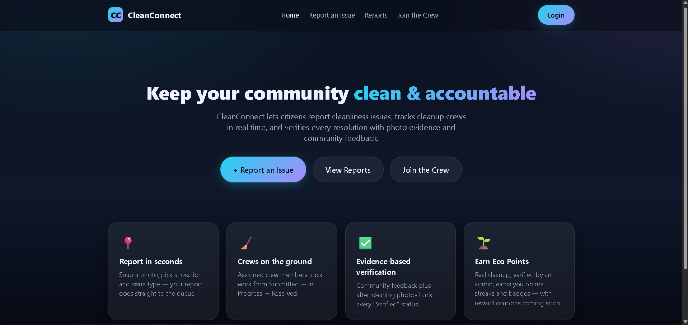

# CleanConnect 🌱

### Community-Powered Waste Reporting & Cleanup Tracking Platform

**CleanConnect** is a civic-tech platform designed to make community waste management more transparent and accountable. Citizens can report illegally dumped waste with photographic evidence, while municipal cleanup teams can manage reports, update progress and document completed work.

🌐 **Live Demo:** [cleanconnect-community.netlify.app](https://cleanconnect-community.netlify.app)

---

## 📸 Application Screenshots

### Main Dashboard


### Crew Recruitment


---


## 📌 About the Project

Illegal waste dumping, including construction debris, electronic waste and other discarded materials, can create environmental and public health concerns.

CleanConnect provides a digital reporting and tracking system that connects citizens, cleanup crews and administrators through a structured workflow.

The platform emphasizes photographic evidence, community feedback and administrative verification rather than treating a report as resolved simply because its status was changed.

## ✨ Key Features

### 👥 Citizen Dashboard
- Register and securely log in.
- Submit waste reports with photographic evidence.
- Track submitted reports and their progress.
- Provide feedback on completed cleanup activities.
- Earn EcoPoints for verified cleanup contributions.

### 🚛 Crew Dashboard
- Access available cleanup reports.
- Accept and manage assigned work.
- Update report progress.
- Upload after-cleanup photographs.
- Track completed activities.

### 🛡️ Admin Dashboard
- Manage users and crew accounts.
- Review and approve crew recruitment applications.
- Monitor submitted reports and cleanup progress.
- Review community feedback.
- Perform final report verification.

### 🌿 EcoPoints & Recognition
- Points for verified cleanup contributions.
- Levels, badges and participation streaks.
- Daily earning limits and fast-resolution bonuses.
- Recognition-based rewards catalog.

*Partner rewards and redemption options are currently marked as coming soon.*

## 🔄 Report Lifecycle

Every report follows a controlled progression:

`Submitted → In Progress → Resolved → Verified`

1. **Submitted:** A citizen reports an issue with a before-cleanup photograph.
2. **In Progress:** A crew member begins the cleanup.
3. **Resolved:** The crew uploads an after-cleanup photograph.
4. **Community Feedback:** The original reporter provides feedback.
5. **Verified:** An administrator reviews the evidence and explicitly confirms the resolution.

The verification process includes a rule-based pre-check. It does not independently verify reports or replace administrator approval.

## 🛠️ Technology Stack

| Component | Technology |
|---|---|
| Frontend | HTML5, CSS3, Vanilla JavaScript |
| Backend | Netlify Functions |
| Runtime | Node.js (ES Modules) |
| Storage | Netlify Blobs |
| Development | Netlify CLI |
| Hosting | Netlify |
| Version Control | Git & GitHub |

## 🔐 Security & Authentication

- Password hashing using Node.js `scrypt`.
- HttpOnly session cookies.
- Server-side role-based access control.
- Protected administrative operations.
- Environment-based administrator configuration.
- Production HTTPS cookie protection.
- Security-related HTTP response headers.

Sensitive credentials are configured through environment variables rather than hardcoded into the frontend.

## 📁 Project Structure

```text
CleanConnect/
│
├── templates/
│   ├── index.html
│   ├── login.html
│   ├── login-portal.html
│   ├── register.html
│   ├── report.html
│   ├── reports.html
│   ├── crew.html
│   ├── admin.html
│   ├── recruit.html
│   ├── eco-points.html
│   │
│   └── static/
│       ├── css/
│       │   └── style.css
│       └── js/
│           ├── api.js
│           ├── navbar.js
│           └── reports-ui.js
│
├── netlify/
│   └── functions/
│       ├── auth-login.mjs
│       ├── auth-register.mjs
│       ├── auth-logout.mjs
│       ├── create-report.mjs
│       ├── get-reports.mjs
│       ├── update-report.mjs
│       ├── verify-report.mjs
│       ├── submit-feedback.mjs
│       ├── upload-after-photo.mjs
│       └── _utils.mjs
│
├── netlify.toml
├── package.json
├── .env.example
├── .gitignore
└── README.md
```

## 🚀 Run Locally

### Prerequisites
- Node.js and npm
- A Netlify account for deployment
- Netlify Blobs and administrator environment configuration

### Installation

Clone the repository:

```bash
git clone https://github.com/2025ee42f-cmd/CleanConnect.git
```

Navigate into the project:

```bash
cd CleanConnect
```

Install dependencies:

```bash
npm install
```

Configure your environment variables using `.env.example` as a template. Set your own administrator email and a strong password. Never commit real credentials.

Start the local development server:

```bash
npx netlify dev
```

Open:

```text
http://localhost:8888
```

Create a public account at `/register.html`.

## 🌐 Live Deployment

CleanConnect v3 is deployed using Netlify.

**Live Application:**  
https://cleanconnect-community.netlify.app

The deployment uses:
- `templates/` as the published directory.
- `netlify/functions/` for serverless backend operations.
- Netlify Blobs for application data storage.

## 🎯 Project Objective

CleanConnect aims to encourage responsible waste disposal, strengthen community participation and improve transparency in local cleanup operations through a simple digital platform.

## 👨‍💻 Developer

**Developed by Om Suresh Sadadekar**

Electrical Engineering Student | Aspiring Software & Technology Engineer

[GitHub](https://github.com/2025ee42f-cmd)

---

*CleanConnect — Report Responsibly. Clean Together. Build a Better Tomorrow.* 🌱
